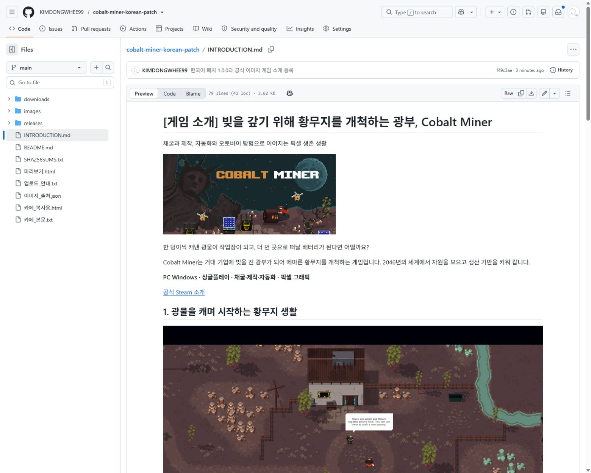

# Cobalt Miner 소개문·GitHub 게시 결과

작성일: 2026-11-02 (한국 시간)

사용자가 요청한 새 공개 저장소에 기존 개인용 패치와 게임 소개를 게시했습니다. 소개문은 `deliverables/SOULASH_2_CAFE_INTRO_20261101/미리보기.html`의 구성과 크기 규칙을 적용했습니다. 대표 이미지, 특징 5개와 각 화면, 추천 대상, 출처 순서이며 갈색 강조색을 사용합니다.

- [공개 저장소](https://github.com/KIMDONGWHEE99/cobalt-miner-korean-patch)
- [공식 이미지 6장으로 보는 게임 소개](https://github.com/KIMDONGWHEE99/cobalt-miner-korean-patch/blob/main/INTRODUCTION.md)
- [한글패치 ZIP](https://github.com/KIMDONGWHEE99/cobalt-miner-korean-patch/raw/refs/heads/main/downloads/COBALT_MINER_KOREAN_PATCH_1.0.0_r1.zip)
- [로컬 HTML 미리보기](../../../deliverables/COBALT_MINER_CAFE_INTRO_20261102/미리보기.html)
- [카페 복사용 본문](../../../deliverables/COBALT_MINER_CAFE_INTRO_20261102/카페_복사용.html)

게시 커밋: `f49c3aec5219a39e75874ee1531f46658c7672d8` (`main`). 별도 GitHub Release는 만들지 않았으며 ZIP은 `downloads` 폴더에 있습니다.

| 검사 | 결과 | 근거 |
|---|---|---|
| 공개 파일 허용 목록 | PASS | 원격 16파일의 경로·Git 내용 지문·크기가 업로드 목록과 일치 |
| 익명 ZIP 다운로드 | PASS | 로그인 없이 다운로드한 6,973,929바이트의 SHA-256이 최종 배포본과 일치 |
| 소개문 구성·파일 연결 | PASS | 이미지 6장, 특징 5개, 추천 항목, 로컬 연결 파일 존재 |
| 카페 복사용 구성 | PASS | 사진 첨부 위치 6개, 본문 선택 버튼·선택 대상 존재 |
| GitHub 소개문 화면 | PASS | 게시된 한글 제목·본문·이미지를 확인하고 화면 저장. 이미지 6장 로딩 완료 |
| 로컬 HTML 화면 | NOT_RUN | 브라우저의 로컬 파일 프로토콜 보안 정책으로 열기가 차단되어 우회하지 않음. 구조 검사를 화면 검수로 간주하지 않음 |

ZIP SHA-256: `e80c32201aebef5941f723ca017c90dd15721c2720a4701f68f84605cda9d615`.

공식 Steam 영문 홍보 화면임을 소개문에 표시했습니다. 원본 게임 자산, 저장 파일, 비공개 분석 자료는 올리지 않았습니다. 기존 패치 ZIP은 변경하지 않았고 추가 게임 실행이나 번역 검수를 수행하지 않았습니다. [기존 패치 확인 범위와 미확인 항목](../ko_1.0.0/RESULT_REPORT.md)은 그대로 유지합니다.

